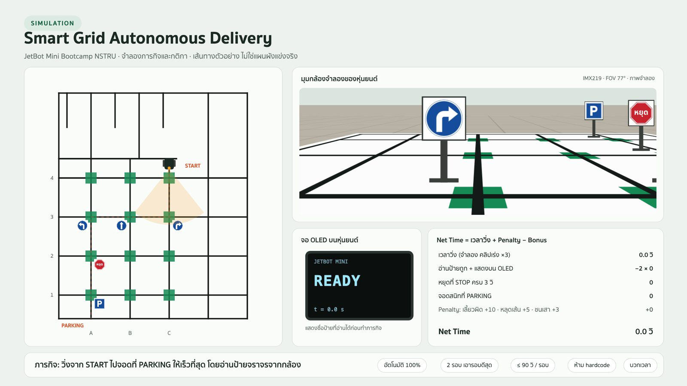

# AI Vision Grand Prix: JetBot Mini Bootcamp @ NSTRU

Bootcamp 6 ชั่วโมงสำหรับนักศึกษา มหาวิทยาลัยราชภัฏนครศรีธรรมราช (NSTRU)
สอนเขียนโค้ดให้ Yahboom JetBot Mini เดินตามเส้นบนสนาม grid อ่านป้ายจราจร 3D Printed แล้วตัดสินใจเองที่ทางแยก
จากนั้นแข่งขัน **Smart Grid Autonomous Delivery** แบบจับเวลาในอีกวันหนึ่ง

[](https://dhanabhon.github.io/jetbot-mini-bootcamp-nstru/assets/video/jetbot-mission.mp4)

*กดที่ภาพเพื่อดูคลิปจำลองการแข่งขัน (31 วินาที) แสดงมุมกล้อง จอ OLED และการคิด Net Time เส้นทางเป็นตัวอย่าง ไม่ใช่แผนผังแข่งจริง รายละเอียดอยู่ใน[โจทย์และกติกาการแข่งขัน](docs/competition-rules.md)*

## ภาพรวม

| หัวข้อ | รายละเอียด |
| :--- | :--- |
| ผู้เข้าอบรม | 10 คน หุ่นยนต์คนละ 1 ตัว (แข่งแบบเดี่ยว) |
| พื้นฐานที่ต้องมี | Python และ OpenCV เบื้องต้น |
| วันอบรม | 1 วัน 6 ชั่วโมง (เช้า 3 ชั่วโมง, บ่าย 3 ชั่วโมง) |
| วันแข่งขัน | 1 วัน แยกจากวันอบรม แข่งกันเองภายในกลุ่ม ไม่มีรางวัล |
| ระหว่างสองวัน | นำหุ่นยนต์กลับไปพัฒนาโค้ดต่อเองได้ |
| Platform | Yahboom JetBot Mini (NVIDIA Jetson Nano, กล้อง IMX219 77° FOV, จอ OLED) |
| เครื่องมือ | Python, Jupyter Lab, OpenCV, PID Control, Edge AI (TensorRT / CNN) |
| เป้าหมาย | ทุกคนเขียนโค้ดที่พาหุ่นยนต์วิ่งจบภารกิจในสนามแข่งได้เอง |

อ่านคู่มือฉบับเว็บได้ที่ <https://dhanabhon.github.io/jetbot-mini-bootcamp-nstru/>

## เริ่มต้นใช้งาน

ครั้งแรกให้ทำตาม[คู่มือการเชื่อมต่อหุ่นยนต์](docs/setup/index.md) (รองรับ Windows และ macOS) หลังจากนั้น

1. เปิดหุ่นยนต์ แล้วต่อคอมพิวเตอร์เข้า Wi-Fi ของหุ่นยนต์ ชื่อและรหัสอยู่บนจอ OLED
2. เปิด Google Chrome ไปที่ `http://10.42.0.1:8888` เพื่อเข้า Jupyter Lab (password `yahboom`)
3. เปิด notebook ตามลำดับใน `notebooks/`

## Notebook แต่ละ module

| Notebook | Module | เวลา |
| :--- | :--- | :--- |
| `01_setup_first_trial.ipynb` | 1: System Architecture & First Trial | 09:00 – 09:45 |
| `02_motor_control_calibration.ipynb` | 2: Differential Drive & Motor Trim | 09:45 – 10:30 |
| `03_line_detection_opencv.ipynb` | 3: Line Detection ด้วย OpenCV | 10:30 – 11:15 |
| `04_pid_line_following.ipynb` | 4: PID Control Tuning | 11:15 – 12:00 |
| `05_traffic_sign_recognition.ipynb` | 5: Traffic Sign Recognition | 13:00 – 14:00 |
| `06_fsm_mission_integration.ipynb` | 6: FSM & Mission Integration | 14:00 – 14:45 |
| `07_competition_template.ipynb` | 7–8: Free Practice และโค้ดสำหรับวันแข่ง | 14:45 – 16:00 |

Notebook ทุกไฟล์เป็นแบบเติมโค้ดในช่อง `TODO` ถ้าตามไม่ทัน ให้เปิดไฟล์เฉลยของ module นั้นใน `notebooks/solutions/` แล้วไปต่อได้เลย

หลังอบรม ใช้ `python3 jetbot_app.py` บนหุ่นยนต์ แล้วเปิด `http://10.42.0.1:8080` จะได้ทุก module เป็นแท็บในหน้าเว็บเดียว ตั้งแต่ตรวจเครื่อง trim จูนเส้น PID อ่านป้าย จนถึงรันทั้งภารกิจ และเพิ่มแท็บของตัวเองได้ ดูวิธีใช้ใน [notebooks/solutions/README.md](notebooks/solutions/README.md)

## โครงสร้าง Repository

```text
jetbot-mini-bootcamp-nstru/
├── README.md
├── jetbot_app.py            # ทุก module ในหน้าเว็บเดียว สำหรับใช้ต่อหลังอบรม
├── docs/                    # เอกสารประกอบ (เผยแพร่เป็น GitHub Pages)
│   ├── setup/                   # คู่มือเชื่อมต่อหุ่นยนต์กับคอมพิวเตอร์
│   ├── syllabus.md              # ตารางอบรม 6 ชั่วโมง
│   ├── competition-rules.md     # โจทย์ กติกา และการคิด Net Time
│   ├── sign-specs.md            # สเปกเสาป้ายจราจร 3D Printed
│   ├── cheatsheet.md            # สรุปคำสั่งและวิธีแก้ปัญหาที่เจอบ่อย
│   └── instructor-guide.md      # checklist และ run-of-show สำหรับผู้สอน
├── notebooks/               # notebook สำหรับผู้เข้าอบรม (มีช่อง TODO)
│   ├── solutions/               # เฉลยและ checkpoint ของแต่ละ module
│   └── src/                     # ต้นฉบับของ notebook ทั้งสองชุด (ผู้สอนแก้ที่นี่)
├── jetbot_nstru/            # โค้ด Python ที่ใช้ร่วมกันหลาย notebook
│   └── app/                     # หน้าเว็บของสคริปต์ทุก module และ jetbot_app.py
├── tests/                   # test ของ jetbot_nstru และ notebook
├── tools/                   # script สร้าง notebook
├── slides/                  # slide ประกอบการสอน
├── competition/             # ใบบันทึกคะแนน และแผนผังวางป้าย
│   └── layouts/
├── dataset/signs/           # ภาพป้ายที่ถ่ายจากกล้องหุ่นยนต์จริง
├── 3d_models/               # ไฟล์ .stl เสาป้ายจราจร
└── stickers/                # ไฟล์ภาพป้ายสำหรับพิมพ์สติ๊กเกอร์
```

## เอกสาร

- [การเชื่อมต่อหุ่นยนต์](docs/setup/index.md)
- [ตารางอบรม](docs/syllabus.md)
- [โจทย์และกติกาการแข่งขัน](docs/competition-rules.md)
- [สเปกเสาป้ายจราจร](docs/sign-specs.md)
- [Cheat sheet](docs/cheatsheet.md)
- [คู่มือผู้สอน](docs/instructor-guide.md)

## License

ดูไฟล์ [LICENSE](LICENSE)
